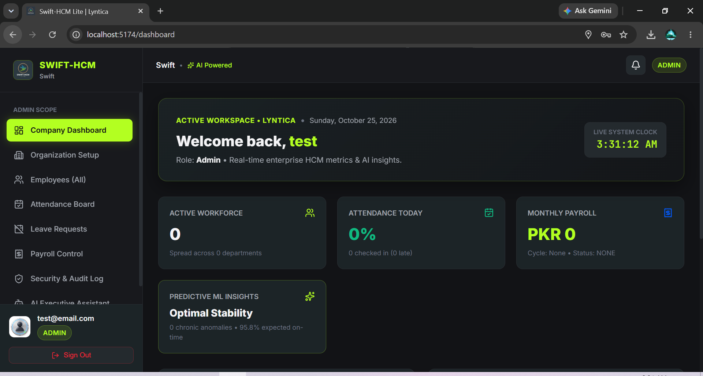

<div align="center">

### بِسْمِ اللّٰهِ الرَّحْمٰنِ الرَّحِيْمِ

### رَبِّ زِدْنِي عِلْمًا

**Swift-HCM Lite ملازمین، حاضری اور تنخواہوں کے انتظام کے لیے ایک ذہین نظام ہے۔**

</div>

# Swift-HCM Lite

**AI-Assisted Human Capital Management System**
Saylani Hackathon 2026 • Zaitoon Ashraf IT Park
Built by **[Lyntica](https://www.lyntica.com/)**

---

## App Snapshot



The admin dashboard brings workforce, attendance, and payroll summaries together, with navigation to organization setup, employee management, leave, audit logs, and the AI assistant. The screenshot shows a fresh workspace; its zero counts are expected because the app starts without seeded demo data.

---

##  Team

* **Murtaza Ali Khan**
  [Portfolio](https://www.murtazalikhan.com) • [GitHub](https://github.com/murtazakhanpro) • [LinkedIn](https://www.linkedin.com/in/murtazakhanpro) • [Hugging Face](https://huggingface.co/murtazakhanpro)
* **Fiza Baneen Khan — Co-founder, Modern Web and App Developer**
  [Portfolio](https://www.fizabaneen.com) • [GitHub](https://github.com/fizabaneen) • [LinkedIn](https://www.linkedin.com/in/fizabaneen)

---

##  Technology Stack

* **Backend:** Python FastAPI (Asynchronous high-throughput, Pydantic V2, PyJWT, Bcrypt)
* **AI & LLM:** Backend-integrated Gemini API; availability depends on server-side API key configuration
* **Database:** Dual-Engine Architecture
  * **Local Zero-Install:** Asynchronous SQLite (`sqlite+aiosqlite`)
  * **Containerized Production / Judging:** PostgreSQL 16 (`postgresql+asyncpg`)
* **Frontend:** React 19 + TypeScript + Vite + Custom CSS Tokens (`#B3FF21` Neon Lime, `#18191D` Slate Canvas, `#015AFF` Blue)
* **Containerization:** Docker Compose

---

##  Data and initial setup

Per the official Saylani HCM Lite challenge rules:
> *"The system starts empty, Admin sets up the company, HR registers employees, and every number comes from what people do in the app."*

* Swift-HCM Lite contains **zero seeded dummy data**.
* On first launch, the application boots into the **First-Run Setup Wizard** where judges configure the organization and register the master Admin account.
* Master Admin then creates HR accounts; HR registers employees.
* Each employee registration automatically generates a portal sign-in with a temporary password that must be updated upon first login.

---

##  Quick Start

### Option A: Local Development (Recommended, Zero External Dependencies)

#### 1. Backend Setup (FastAPI)
```powershell
# In the root repository directory:
python -m pip install -r backend/requirements.txt

# Run the FastAPI server:
python -m uvicorn app.main:app --app-dir backend --reload --port 8000
```
*API Swagger Documentation will be accessible at: [http://localhost:8000/docs](http://localhost:8000/docs)*

#### 2. Frontend Setup (React 19 + Vite)
```powershell
# In a new terminal:
cd frontend
npm install
npm run dev
```
*Web Application will be accessible at: [http://localhost:5173](http://localhost:5173)*

---

### Option B: Docker Compose (Full Stack with PostgreSQL)

```powershell
# Set your Gemini API Key in .env, then run:
docker compose up --build
```
*Frontend runs on [http://localhost:3000](http://localhost:3000)*
*Backend runs on [http://localhost:8000](http://localhost:8000)*

---

## Automated Backend Tests

The current automated suite contains unit and API integration tests. It is not a complete end-to-end, browser, security, or performance test suite.

```powershell
python -m pytest backend/tests/ -v
cd frontend
npm run build
```

## Current Implementation Status

The nine product areas have implementations in the repository. Passing tests provide partial coverage and do not establish release readiness for the full 25-item brief.

| Module | Current code | Verification status |
| :--- | :--- | :--- |
| M1 Authentication and access | First-run setup, login, password change, role checks, user management | API tests exist; rate limits and password reset workflow need further work |
| M2 Organization setup | Company settings, departments, designations, holidays, leave quotas | API tests exist; database migrations and effective-dated settings are not implemented |
| M3 Employees | Profiles, directory, search, CSV preview/export | API and UI exist; pagination and cross-organization isolation need further work |
| M4 Attendance | Check-in/out, status rules, correction requests, camera/geofence UI | API tests exist; concurrency and timezone edge cases need more coverage |
| M5 Leave | Requests, balances, overlap checks, HR decisions | API/UI implemented; full policy edge-case coverage remains incomplete |
| M6 Payroll | Drafts, tax, deductions, finalization, payslip views | API tests exist; tax slabs now match the brief; storage still uses floating-point columns |
| M7 Dashboards and analytics | Role-based dashboard summaries and attendance/department views | Implemented; formulas and filters need broader fixture-backed tests; no predictive ML model is included |
| M8 AI assistant | Backend tools, Gemini integration, scoped employee/payroll paths, grounded fallback | Implemented; provider timeout, rate limiting, evaluation cases, and structured smart-leave flow need further work |
| M9 Communications and audit | Announcements, notifications, audit records and audit view | Implemented; audit immutability and event coverage need further verification |

### Local environment

Use the project-root `.env` as the single environment configuration for local development and Docker. Keep it out of Git. Set a unique `JWT_SECRET` (at least 32 characters) for Docker/production. `GEMINI_API_KEY` stays server-side; `AI_MODEL` selects the Gemini model used by the assistant. The backend reads this same root `.env`, so the configured Gemini key and model apply consistently. Set `CORS_ORIGINS` to the exact frontend origins when hosting frontend and backend separately.

Attendance face verification uses the [Apache-2.0 AuraFace ONNX model](https://huggingface.co/fal/AuraFace-v1). Set `FACE_ENCRYPTION_KEY` to a Fernet key, keep `FACE_MODEL_ID=fal/AuraFace-v1`, and use `FACE_MATCH_THRESHOLD=0.65` as the starting cosine-similarity threshold. The first enrollment or face check downloads only the detector and recognition files into the Hugging Face cache; to pre-download them, run `python backend/scripts/download_face_model.py`. Employees can enroll during HR registration when explicit consent is provided, or enroll later from the Attendance page. Images are processed by the backend and discarded; encrypted 512-dimensional templates are stored in the database. Existing templates created with a previous model must be re-enrolled. Docker persists the model cache in the `face_model_cache` volume.

The development frontend uses relative `/api/v1` requests and Vite proxies them to `http://127.0.0.1:8000`. The Docker frontend proxies API requests through Nginx.

Backend operational endpoints are `/api/v1/health` and `/api/v1/ready`; the latter returns HTTP 503 when the database cannot be reached.

### Known limitations

- The application currently creates tables with SQLAlchemy `create_all`; it does not have a migration history.
- Payroll fields are persisted as floating-point SQL columns, despite decimal-safe tax computation.
- API rate limiting, complete browser accessibility checks, cross-organization tenancy, and load-test evidence are not established.
- The current automated tests are a small backend suite; no full browser end-to-end suite or performance report is present.
- Gemini-dependent behavior requires a valid server-side API key and has not been verified against a live provider during this change.

### Credits

Swift-HCM Lite is a Lyntica product. Team links:

- Murtaza Ali Khan: [Portfolio](https://www.murtazalikhan.com), [GitHub](https://github.com/murtazakhanpro), [LinkedIn](https://www.linkedin.com/in/murtazakhanpro), [Hugging Face](https://huggingface.co/murtazakhanpro)
- Fiza Baneen Khan, Co-founder and Modern Web and App Developer: [Portfolio](https://www.fizabaneen.com), [GitHub](https://github.com/fizabaneen), [LinkedIn](https://www.linkedin.com/in/fizabaneen)
